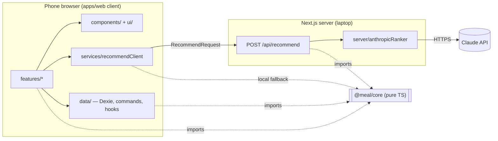
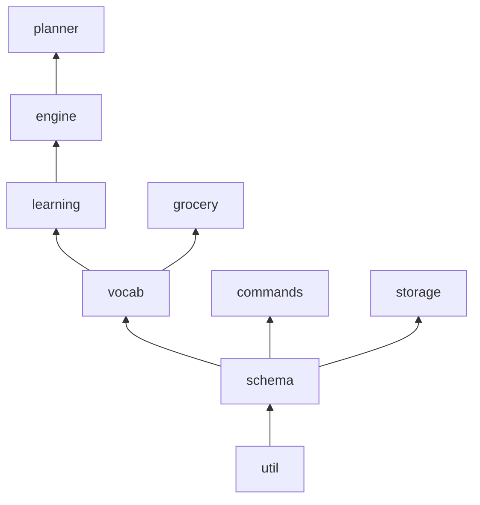
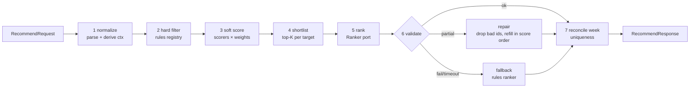

# Meal Recommender — Design v1

| | |
|---|---|
| **Date** | 2026-10-10 |
| **Status** | Draft for review (gate before implementation plan) |
| **Author** | Manish Sharma |
| **Inputs** | Requirements + UI decisions of 2026-10-10; mockups (12 boards, A1–A3, 1–9) |
| **Next** | Review → implementation plan (`writing-plans`) → code, bottom-up |

---

## 0. Bottom line

We build a **pnpm workspace with two parts**:

- **`@meal/core`** — a framework-free, I/O-free TypeScript library that holds every rule of the product: schemas, vocabulary, the recommendation engine, week planner, grocery builder, learning, and the pure logic of every user action.
- **`apps/web`** — a thin Next.js shell that renders core, persists in IndexedDB, and hosts **one** server route that adds Claude ranking.

Everything likely to change sits behind **exactly one seam** — a config object, a registry array, or a port — so a new requirement is an edit in one place, not a refactor (§11 maps likely changes to seams). We build bottom-up: core first, proven by tests and a CLI script before any screen exists. **First daily-usable state is Today + onboarding.** Effort **~75–115 focused hours** (§12 assumptions).

**Headline decisions**

1. **One schema layer is the contract.** zod schemas define catalog, storage records, API payloads, LLM output and backup files. Types are inferred from them, never hand-written twice.
2. **One pipeline, three callers.** Today, Week and Swap all call `recommend()`. They differ only in how many slot targets they send.
3. **Feedback is an append-only event log; taste profiles are projections.** The learning maths can change any time without losing a single tap of history.
4. **Rules and scorers are plain registries; all weights live in one `EngineConfig`.** A new preference is one object added to an array.
5. **Core is isomorphic.** The same `recommend()` runs on the server with Claude, and on the phone with the rules-only ranker when the server or the network fails.

---

## 1. Context and settled inputs

The household (four members, vegetarian + eggs, different tastes) needs a daily answer to "what do I cook", a week plan with a grocery list, and suggestions that use what is at home. The daily user is on a phone. The following were settled on 2026-10-10 and are built on, not re-argued:

| Area | Settled |
|---|---|
| Stack | Next.js App Router + TypeScript, Bootstrap 5 via react-bootstrap, mobile-first, `src/` layout, Vitest + Playwright |
| Engine | Rules + LLM hybrid: normalize → hard filter → soft score → shortlist → Claude rank → validate → repair/fallback. Claude (small model) only ranks and explains, server-side only |
| Data | Own seeded catalog (~150 meals, LLM-drafted JSON, reviewed). Nutrition = tags + approx kcal |
| Storage | IndexedDB on the phone, no auth/sync. API key in `.env.local`, run locally (no hosting/PWA in v1) |
| Learning | ~2-min first-run taste chips per member + "Cook this" / "Not this" taps, per member |
| Semantics | Spice is a soft score ("mild base, heat on the side"); pantry is a lightweight boost; dislikes are a heavy penalty, not exclusion; strictest member wins for hard rules |
| UI | Today-first home, Week list + swap sheet, Grocery, Family, Settings, 3-step onboarding, tablet/desktop week grid |

### Refinements introduced by this design (visible deltas)

> **C1 — Member vetoes collapse into two existing mechanisms.** The earlier request shape carried `vetoes` separately. A veto is really two things: a learning signal (a `meal.rejected` event with `memberIds`) and a "not tonight" exclusion (`excludeIds`). Keeping a third field would duplicate both. The request keeps `excludeIds`; vetoes travel as events.
>
> **C2 — Member verdict chips are deterministic.** "Son likes it / Wife is okay" is computed by code from taste profiles. Claude writes only the one-line reason. A model never asserts a fact about a person's taste.
>
> **C3 — Today's hero reads the plan first.** If a plan entry exists for (today, slot) the hero shows it; otherwise it shows a live suggestion that is persisted only on "Cook this". Today and Week are two views over the same records.

---

## 2. Design principles → concrete seams

| Principle | How it shows up | What it buys when requirements change |
|---|---|---|
| **KISS** | Plain functions and arrays. No DI container, no state library, no generic repository framework | New contributors (or future-us) read it top to bottom |
| **DRY** | zod schemas are the single type source; one `recommend()`; one command runner; one migration chain; one vocabulary for chips, catalog, pantry and grocery | A field or rule changes once |
| **SESE** (single entry, single exit) | One read entry (`recommend`), one write entry (`run(command)`), one server boundary (`POST /api/recommend`), one migration path used by DB upgrade and backup import | No side door skips validation or the event log |
| **Pure core, I/O at the edges** | Core imports nothing from React, Next, Dexie or the Anthropic SDK. The only async port is `Ranker` | Storage, hosting, LLM vendor are swappable adapters |
| **Open/closed by registry** | `rules[]`, `scorers[]`, `reasonSignals` table | Add behaviour without editing the pipeline |
| **Parameterize, don't fork** | `EngineConfig`, `LearningConfig`, household settings | Tuning is a data edit, later a settings slider |
| **Events are truth, state is derived** | Taste profiles = `project(events)` | Learning can be redesigned and replayed |
| **Agents propose, code decides** | Claude may only reorder a code-built shortlist; code validates and owns the final pick | LLM failure degrades quality, never correctness |

**Deliberately not doing (YAGNI, each with a revisit trigger)**

| Not now | Revisit when |
|---|---|
| `packages/ui` | A second frontend appears |
| Global state library (Redux/Zustand) | Cross-feature ephemeral state outgrows URL + React state |
| Embeddings / vector similarity | Catalog > ~1,000 meals or "more like this" is requested |
| Server database, auth, sync | Second device or second household |
| LLM response cache | Measured repeated identical calls (Show another already reuses backups) |
| Storybook | More than one person builds UI; until then a dev-only `/dev/ui` gallery page |

---

## 3. Atomic unit and scope ladder

**Atomic unit: the slot decision — `PlanEntry` keyed `(date, slot)`.** Every suggestion, cook, rejection, swap and grocery line keys onto it.

Constraints bind on a ladder; local first, global checked after:

| Level | Binds here | Mechanism |
|---|---|---|
| **Slot** | Diet, slot suitability, max minutes, blocked meals, `excludeIds` | Hard rules |
| **Slot** | Taste fairness, recency, pantry, time fit, spice | Scorers |
| **Day** | Balance (heavy lunch → lighter dinner) | `dayBalance` scorer using other slots of the same day |
| **Week** | No repeats; cuisine variety | Reconcile pass after ranking (generate-then-reconcile) |

---

## 4. Top-down decomposition

### Level 0 — system



### Level 1 — modules

| Module | Lives in | Responsibility | Depends on |
|---|---|---|---|
| `schema` | core | zod schemas + inferred types for every record and payload | zod |
| `vocab` | core | Tag + ingredient registry; derives a meal's effective tags; validates catalog references | schema |
| `learning` | core | Event → per-member taste profile projection; verdicts | schema, vocab |
| `engine` | core | Rules, scorers, pipeline, Ranker port, rules ranker, validation/repair, explanations | schema, vocab, learning |
| `planner` | core | `planWeek`, `swapOptions` — thin wrappers that build targets and call `recommend` | engine |
| `grocery` | core | Plan → aggregated, categorised, pantry-aware list; quantity formatting | schema, vocab |
| `commands` | core | Pure `decide(command, state) → effects` for every user action | schema |
| `storage` | core | App-data schema version, record migrations, backup envelope | schema |
| `util` | core | Dates (local `YYYY-MM-DD`), stable sort, clamp, `Result` | — |
| `ui/` | web | Domain-free primitives wrapping react-bootstrap | react-bootstrap |
| `components/` | web | Domain-aware shared pieces (MealCard, MemberAvatar, TasteChipEditor) | ui, core types |
| `features/*` | web | One vertical slice per screen | components, data, services |
| `data/` | web | Dexie DB, live-query hooks, command runner, backup I/O | core |
| `services/` | web | `recommendClient` (server first, local fallback) | core |
| `server/` | web | `anthropicRanker` adapter (`server-only`) | core, Anthropic SDK |
| `content/` | web | `catalog.json`, `vocab.json` — data, not code | — |

### Level 2 — the shared library is §5; the app is §9.

---

## 5. `@meal/core` — the shared library

### 5.1 Layout and dependency rule

```
packages/core/
  package.json            # "name": "@meal/core", "main": "src/index.ts" — internal package, no build step
  src/
    schema/   meal.ts household.ts plan.ts events.ts pantry.ts api.ts rank.ts index.ts
    vocab/    vocabulary.ts validateCatalog.ts
    learning/ projectHousehold.ts verdict.ts config.ts
    engine/   rules/  scorers/  pipeline.ts  ranker.ts  rulesRanker.ts  validateRank.ts  explain.ts  config.ts
    planner/  planWeek.ts swapOptions.ts
    grocery/  buildGroceryList.ts formatQty.ts
    commands/ commands.ts decide.ts
    storage/  version.ts migrations.ts backup.ts
    util/     date.ts sort.ts result.ts
    index.ts  # the only public entry — SESE for the package
  test/fixtures/  household.ts catalog.small.json vocab.small.json
```

Arrow reads "is used by"; nothing points back down.



Enforced, not hoped for: ESLint `no-restricted-imports` blocks `react`, `next`, `dexie`, `@anthropic-ai/*` inside `packages/core`; `import/no-cycle` on. Next consumes it via `transpilePackages: ['@meal/core']`. **zod is core's only runtime dependency.**

### 5.2 `schema` — the contract

```ts
// schema/meal.ts
export const Slot = z.enum(['breakfast', 'lunch', 'snack', 'dinner']); // new slot = one enum edit
export const Diet = z.enum(['veg', 'egg']);                           // 'nonveg' later = one enum edit

export const Meal = z.object({
  id: z.string().regex(/^[a-z0-9-]+$/),   // stable slug — all history keys onto it, never renamed
  name: z.string().min(2),
  slots: z.array(Slot).min(1),
  diet: Diet,
  minutes: z.number().int().positive(),
  kcal: z.number().int().positive(),      // approximate, per serving
  spice: z.number().int().min(0).max(3),  // 0 mild … 3 hot; soft-scored, never filtered
  heaviness: z.enum(['light', 'medium', 'heavy']),
  cuisine: z.string(),                    // a vocab tag id
  tags: z.array(z.string()),              // dish family / nutrition / trait tag ids
  ingredients: z.array(z.object({
    id: z.string(),                       // vocab ingredient id; unit comes from vocab (DRY)
    qtyPerServing: z.number().positive(),
    optional: z.boolean().default(false),
  })),
  staple: z.boolean().default(false),     // cold-start prior: a household regular
});
export type Meal = z.infer<typeof Meal>;  // types are inferred, never hand-written
```

Other schemas, same pattern:

| Schema | Key fields |
|---|---|
| `Member` | `id, name, color, active, hard?: { diets?: Diet[]; excludeTags?: string[] }` |
| `HouseholdSettings` | `enabledSlots, maxPrepMinutes, weekStartsOn, aiEnabled, noRepeatsInWeek, lastBackupAt?` |
| `PlanEntry` | `date, slot, mealId, status: planned\|cooked\|skipped, source: ai\|rules\|manual, reason?, updatedAt` |
| `FeedbackEvent` | discriminated union on `type`: `taste.set`, `meal.cooked`, `meal.rejected`, `meal.blocked`, `meal.swapped`; common `id, at, v` |
| `PantryItem` | `ingredientId, have, updatedAt` |
| `RecommendRequest` / `RecommendResponse` | §6.4 |
| `RankInput` / `RankOutput` | §6.3 |
| `BackupEnvelope` | `app, schemaVersion, exportedAt, data` |

### 5.3 `vocab` — one vocabulary for everything

The risk "taste chips must map to catalog tags" is closed structurally: chips, catalog tags, pantry items and grocery lines all come from one registry.

```ts
// content/vocab.json shape (validated by schema)
{ "tags":        [{ "id": "dosa", "label": "Dosa", "kind": "dish", "chip": true }, …],
  "ingredients": [{ "id": "spinach", "label": "Spinach", "category": "vegetables",
                    "unit": "g", "tag": "spinach", "pantry": true }, …] }
```

```ts
export function createVocabulary(data: VocabData): Vocabulary;
// Vocabulary:
//   tagsOf(meal)       -> Set<string>  // meal.tags ∪ cuisine ∪ tags of its ingredients — authors never list spinach twice
//   chipTags()         -> Tag[]        // onboarding + Family chips are generated, never hand-listed
//   ingredient(id)     -> Ingredient   // unit, category, label
export function validateCatalog(meals: unknown, vocab: Vocabulary): Result<Meal[], CatalogIssue[]>;
// unknown tag/ingredient, duplicate id, slot-less meal → issue. Run by `pnpm validate:content`; build fails on any issue.
```

### 5.4 `learning` — projections over events

```ts
export function projectHousehold(events: FeedbackEvent[], meals: MealIndex, vocab: Vocabulary,
                                 now: Date, cfg = defaultLearningConfig):
  { profiles: Map<MemberId, TasteProfile>; blockedMealIds: Set<string> };
// TasteProfile = { affinity: Map<tagId, number /* -1..1 */>; disliked: Set<tagId> }
export function memberAffinity(profile: TasteProfile, mealTags: Set<string>): number; // -1..1
export function verdict(affinity: number, cfg): 'likes' | 'okay' | 'dislikes';
```

| Event | Signal (all constants in `LearningConfig`) |
|---|---|
| `taste.set like` | affinity[tag] = +0.8 (explicit, latest wins) |
| `taste.set dislike` | tag → `disliked` (meal affinity forced to −1 → heavy penalty, not exclusion) |
| `taste.set none` | clears explicit value |
| `meal.cooked` | each active member, each meal tag: +0.10 × decay |
| `meal.rejected` with `memberIds` | those members, each meal tag: −0.25 × decay |
| `meal.rejected` reason only | mapped by `reasonSignals`: `recent` → none (recency scorer covers it), `heavy` → none in v1, `no-time`/`missing-ingredient` → none |
| `meal.blocked` | household-level hard exclusion ("Never suggest this again") |

`decay = 0.5^(ageDays / halfLifeDays)`, half-life 45 days. `projectHousehold` is recomputed on load — at household scale (hundreds to low thousands of events) it is milliseconds, so no stored profile can drift from its events.

### 5.5 `engine` — rules, scorers, pipeline

```ts
// engine/rules/types.ts — hard constraints. A meal failing any rule is never shown.
export interface Rule {
  id: string;
  allows(meal: Meal, ctx: TargetContext): boolean;
}
// v1 registry — adding a rule is adding a line
export const rules: Rule[] = [dietRule, slotRule, maxMinutesRule, blockedRule, excludeIdsRule, memberHardRule];
// memberHardRule = "strictest member wins": intersection of allowed diets, union of excluded tags

// engine/scorers/types.ts — soft preferences
export interface Scorer {
  id: keyof EngineConfig['weights'];                      // id doubles as the weight key — no second mapping
  score(meal: Meal, ctx: TargetContext): number;          // normalised to -1..1
  explain?(meal: Meal, ctx: TargetContext): string | undefined; // template reason for rules-only mode
}
export const scorers: Scorer[] = [taste, recency, pantry, timeFit, spice, dayBalance, staple];

// engine/config.ts — the ONLY tuning knob
export const defaultEngineConfig = {
  weights: { taste: 1.0, recency: 0.6, pantry: 0.4, timeFit: 0.3, spice: 0.3, dayBalance: 0.3, staple: 0.15 },
  fairness: 1.0,                 // λ: how hard one member's dislike drags a meal down
  shortlistSize: 10,
  backups: { today: 3, swap: 8 },
  recencyWindowDays: 14,
  verdict: { likes: 0.3, dislikes: -0.3 },
  ranker: { timeoutMs: { single: 6_000, batch: 20_000 }, rankBatchSize: 28 },
} satisfies EngineConfig;
```

**Household taste (the "please everyone" maths).** For meal *x* and members *m*:

`taste(x) = mean_m a_m(x) − λ · max(0, −min_m a_m(x))`

One member who dislikes a meal pulls it down by λ on top of the average, so a meal three love and one hates loses to a meal everyone finds okay. λ is `fairness`.

**Total score** `Σ weights[s.id] × s.score(x)`; ties broken by `mealId` — deterministic, so "why this one?" always has an answer.

```ts
// engine/pipeline.ts — the single read entry used by Today, Week and Swap
export async function recommend(req: RecommendRequest, deps: EngineDeps): Promise<RecommendResponse>;
// EngineDeps = { meals, vocab, ranker: Ranker, config: EngineConfig, now: Date }
```

### 5.6 `planner`, `grocery`, `commands`, `storage`

```ts
// planner — wrappers, no logic of their own (DRY)
export function planWeekRequest(weekStart: string, state: PlanningState): RecommendRequest; // skips cooked/manual entries
export function swapRequest(entry: PlanEntry, week: PlanEntry[]): RecommendRequest;         // excludeIds = rest of week

// grocery
export function buildGroceryList(entries: PlanEntry[], meals: MealIndex, vocab: Vocabulary,
                                 opts: { servings: number; pantry: Set<string> }): GroceryList;
// qty × servings → sum by ingredient → round to buyable step → group by vocab category → inPantry items pre-checked
export function formatQty(qty: number, unit: 'g' | 'ml' | 'pcs'): string; // "750 g", "1 kg", "12 pcs" — shared with UI

// commands — the pure half of every user action
export type Command =
  | { type: 'cookThis'; date: string; slot: Slot; mealId: string; source: Source; reason?: string }
  | { type: 'notThis'; date: string; slot: Slot; mealId: string; memberIds: string[]; reason?: RejectReason }
  | { type: 'blockMeal'; mealId: string }
  | { type: 'acceptPlan'; entries: PlanEntryDraft[] }
  | { type: 'swap'; date: string; slot: Slot; toMealId: string }
  | { type: 'setTaste'; memberId: string; tagId: string; value: 'like' | 'dislike' | 'none' }
  | { type: 'upsertMember'; member: MemberDraft } | { type: 'removeMember'; memberId: string }
  | { type: 'updateSettings'; patch: Partial<HouseholdSettings> }
  | { type: 'setPantry'; ingredientIds: string[] }
  | { type: 'toggleGrocery'; weekStart: string; ingredientId: string };

export function decide(cmd: Command, state: CommandState, deps: { now: Date; newId: () => string }): Effects;
// Effects = { events?, plan?, members?, settings?, pantry?, grocery? } — all "put" semantics, applied atomically by the app

// storage
export const SCHEMA_VERSION = 1;
export const migrations: Record<number, (d: unknown) => unknown>; // n → n+1, pure
export function migrate(data: unknown, from: number): AppData;      // used by DB upgrade AND backup import
export function toBackup(data: AppData, now: Date): BackupEnvelope;
export function fromBackup(raw: unknown): Result<AppData, string>;   // parse → migrate → validate
```

---

## 6. Recommendation pipeline (data flow)

### 6.1 Flow



| Stage | In → Out | Owner | On failure |
|---|---|---|---|
| 1 normalize | request → `TargetContext[]` (profiles, today's other slots, pantry set, history) | Code | 400 at route |
| 2 hard filter | 150 meals → eligible set | Code | Empty set → response flags `noEligible`, UI asks to relax max-minutes |
| 3 soft score | eligible → scored | Code | — |
| 4 shortlist | scored → top 10 per target | Code | — |
| 5 rank | shortlists → order + reasons | **Claude** (or rules ranker) | timeout → fallback |
| 6 validate | rank output → checked | Code | repair or fallback; never trust model output |
| 7 reconcile | per-target picks → week-consistent picks | Code | duplicate keeps higher-scored slot, other takes next unused backup |

Week mode runs stages 1–4 slot by slot in date order; each target's **deterministic** top pick is fed into the next targets' day context (provisional), then **one batched rank call** covers all targets, then reconcile. Today sends one target; Swap sends one target with more backups.

### 6.2 Technology allocation

| Capability | Owner | Why |
|---|---|---|
| Diet, slot, time, blocks, exclusions | Code | Hard rules must be exact |
| Taste fairness, recency, pantry, spice, day balance | Code | Maths over known data |
| Member verdict chips | Code | Facts about people come from data (C2) |
| Final ordering within the shortlist | Claude | Fuzzy "what feels right tonight" judgment |
| One-line natural reason | Claude (template when rules-only) | Language |
| Week uniqueness, final pick | Code | Global constraint, deterministic |
| Accept / reject | Human | The tap is the checkpoint, and it is captured as an event |

### 6.3 Ranker port and contract

```ts
export interface Ranker {
  rank(input: RankInput, opts: { signal: AbortSignal }): Promise<unknown>; // unknown on purpose — validated next
}
// RankInput  = { members: {id,name}[]; targets: { key: string; slot: Slot; date: string;
//               candidates: { id; name; tags; minutes; kcal; spice; score; verdicts }[] }[] }
// RankOutput = { targets: { key: string; order: string[]; reasons: Record<string, string> }[] }

export function validateRank(raw: unknown, input: RankInput): { output: RankOutput; repaired: boolean } | null;
// rules: order ⊆ that target's candidate ids, no duplicates; reasons ≤ 120 chars.
// repair: keep valid ids in model order, append missing ids in score order, template-fill missing reasons.
// null (unparseable / no targets) → caller uses rulesRanker.

export const rulesRanker: Ranker; // identity order + explain() templates — also the offline path
```

The model can only **reorder ids it was given**. It cannot add a meal, bypass a rule or invent a verdict, because every one of those is decided before or checked after it.

### 6.4 API payloads

```ts
RecommendRequest = {
  targets: { date: string; slot: Slot; maxMinutes?: number; excludeIds?: string[]; backups?: number }[];
  context: { members: Member[]; settings: HouseholdSettings; profiles: SerializedProfiles;
             blockedMealIds: string[]; pantry: string[]; history: PlanEntry[] /* last recencyWindowDays + current week */ };
};
RecommendResponse = {
  results: { date: string; slot: Slot; source: 'ai' | 'rules'; noEligible?: true;
             pick: Suggestion; backups: Suggestion[] }[];
};
Suggestion = { mealId: string; score: number; reason: string; verdicts: Record<MemberId, Verdict> };
```

Profiles are projected on the phone (learning is core, so it runs anywhere) and sent derived — smaller than raw events, and the server stays stateless. "Show another" walks the backups already returned; no new call.

---

## 7. Data model and storage

### 7.1 IndexedDB (Dexie) stores

| Store | Key | Notes |
|---|---|---|
| `members` | `id` | |
| `settings` | `'household'` (singleton) | |
| `plan` | `[date+slot]` | index `date` for week/day ranges |
| `events` | `id` | index `at`, `type`; append-only — never updated, never deleted except "Clear all data" |
| `pantry` | `ingredientId` | |
| `grocery` | `[weekStart+ingredientId]` | checked state only; the list itself is always derived |
| `meta` | `key` | `schemaVersion` |

Catalog and vocab are **not** stored — they ship as static content in the bundle, so a catalog fix reaches the phone on the next page load.

### 7.2 The single write path

```ts
// apps/web/src/data/run.ts — every UI action goes through here (SESE for writes)
export async function run(cmd: Command): Promise<void> {
  const state = await loadCommandState(db, cmd);                 // only what decide() needs
  const effects = decide(cmd, state, { now: new Date(), newId }); // pure, from @meal/core — tested there
  await db.transaction('rw', db.tables, () => applyEffects(db, effects)); // atomic: event + plan land together or not at all
}
```

### 7.3 Versioning and backup

- Dexie `version(n).stores(...)` owns indexes; record-shape changes run through core `migrations[n]` inside Dexie's `upgrade()` hook.
- Export = `toBackup()` → JSON file download. Import = `fromBackup()` → same migrate chain → replace all stores in one transaction.
- Backup nudge: banner on Today when `lastBackupAt` is missing or older than 7 days.

---

## 8. Learning and personalization lifecycle

1. **First run (A1–A3):** members, then tri-state chips per member → `taste.set` events. Chips come from `vocab.chipTags()`.
2. **Daily:** "Cook this" → `meal.cooked` + plan entry `cooked`. "Not this" → `meal.rejected` (members and/or reason) + the meal joins `excludeIds` for the next request. "Never suggest again" → `meal.blocked`.
3. **Family screen:** the same `setTaste` command as onboarding (same `TasteChipEditor` component).
4. **Cold start:** explicit chips + `staple` prior + fairness penalty carry the first week before implicit signals accumulate.

---

## 9. `apps/web` — the shell

### 9.1 Layout

```
apps/web/
  src/app/
    (tabs)/layout.tsx           # AppShell: bottom nav < lg, side nav ≥ lg
    (tabs)/page.tsx             # Today
    (tabs)/week/page.tsx  (tabs)/grocery/page.tsx  (tabs)/family/page.tsx  (tabs)/settings/page.tsx
    onboarding/page.tsx
    dev/ui/page.tsx             # primitive gallery, dev builds only
    api/recommend/route.ts      # the only server route
  src/features/{today,week,grocery,family,settings,onboarding}/   # vertical slices
  src/components/               # domain-aware shared: MealCard, MealMeta, MemberAvatar, VerdictChip, TasteChipEditor
  src/ui/                       # domain-free primitives; the only folder that imports react-bootstrap
  src/data/                     # db.ts, run.ts, hooks.ts, backup.ts
  src/services/recommendClient.ts
  src/server/anthropicRanker.ts # import 'server-only'
  src/content/catalog.json  vocab.json
  src/styles/theme.scss         # Bootstrap variable overrides = the design tokens, defined once
  scripts/validate-content.ts  try-recommend.ts
```

Routes only compose features. Features never import each other; shared needs move down to `components/` or `ui/`.

### 9.2 Shared UI — what the mockups reuse

| Primitive / component | Tier | Used on boards | Parameterized by |
|---|---|---|---|
| `AppShell`, `NavBar` | ui | all tabs, 9 | breakpoint → bottom / side |
| `PageHeader` | ui | all | eyebrow, title, action slot |
| `BottomSheet` | ui | 2 Not this, 3 Pantry, 5 Swap | title, subtitle, body, footer (Offcanvas `placement="bottom"`) |
| `ChipToggle` / `ChipGroup` | ui | slot selector, context chips, pantry, reject reasons, A2 tastes, 7 Family | `states` (2-state or like/won't/none), `multi`, icon |
| `ListRow` | ui | Also today, Grocery, Settings | leading, title, subtitle, trailing |
| `Badge`, `SectionLabel`, `ProgressBar`, `Stepper` | ui | many | tone / value / step |
| `AsyncState` | ui | every feature | loading / empty / error |
| `MealCard` | components | 1 hero, 4 day list, 5 options, 9 grid cell | `variant: hero \| compact \| option`, actions slot |
| `MealMeta` | components | wherever a meal appears | "40 min · ~540 kcal" + spice badge |
| `MemberAvatar`, `VerdictChip` | components | 1, 2, A2, 7 | member, verdict |
| `TasteChipEditor` | components | A2, 7 | member, tags |

Three sheets, six chip uses and four meal-card placements each collapse to one component.

### 9.3 Feature slices

| Route | Boards | Feature components | Core calls / commands |
|---|---|---|---|
| `/` Today | 1, 2, 3 | `TodayHero`, `SlotSelector`, `ContextChips`, `NotThisSheet`, `PantrySheet`, `AlsoToday` | `recommend` (1 target); `cookThis`, `notThis`, `blockMeal`, `setPantry` |
| `/week` | 4, 5, 9 | `DayStrip`, `WeekDayList`, `WeekGrid` (≥ lg), `SwapSheet` | `planWeekRequest`, `swapRequest`; `acceptPlan`, `swap` |
| `/grocery` | 6 | `GroceryList`, `CopyListButton` | `buildGroceryList`; `toggleGrocery` |
| `/family` | 7 | `HouseRulesCard`, `MemberTasteCard` | `setTaste`, `upsertMember`, `updateSettings` |
| `/settings` | 8 | `BackupCard`, `PlanningPrefs`, `DangerZone` | `toBackup`/`fromBackup`; `updateSettings` |
| `/onboarding` | A1–A3 | `MembersStep`, `TastesStep`, `DoneStep` | `upsertMember`, `setTaste` (same as Family) |

### 9.4 Data hooks and the recommend client

```ts
// data/hooks.ts — reads are live queries; React state only for ephemeral UI (open sheet, selected slot)
useSettings(); useMembers(); usePlan(fromDate, toDate); usePantry(); useGroceryChecks(weekStart);
useProfiles();   // useLiveQuery(events) → projectHousehold, memoised

// services/recommendClient.ts — one function, two paths, same core
export async function getRecommendations(req: RecommendRequest): Promise<RecommendResponse> {
  if (!req.context.settings.aiEnabled) return recommendLocally(req);   // AI off: zero network calls
  try { return await postJson('/api/recommend', req, { timeoutMs: 25_000 }); }
  catch { return recommendLocally(req); }                               // server unreachable: rules ranker on the phone
}
const recommendLocally = (req) => recommend(req, { meals, vocab, ranker: rulesRanker, config, now: new Date() });
```

### 9.5 Server route

```ts
// app/api/recommend/route.ts
export async function POST(request: Request) {
  const parsed = RecommendRequest.safeParse(await request.json()); // contract enforced at the boundary
  if (!parsed.success) return Response.json({ error: 'invalid_request' }, { status: 400 });
  const res = await recommend(parsed.data, { meals, vocab, ranker: anthropicRanker, config, now: new Date() });
  return Response.json(res);  // recommend() never throws on LLM failure — it falls back inside
}
// server/anthropicRanker.ts: model from ANTHROPIC_MODEL env (small-model default), JSON-only system prompt,
// max_tokens capped, AbortSignal timeout, no retry loop — fallback is the retry.
```

### 9.6 Runtime constraints of "run locally" (feasibility first)

**Assumption:** the phone opens the app from the laptop over home Wi-Fi (`http://<lan-address>:3000`, production build via `next start`). That origin is **not a secure context**, which has concrete consequences we design for now rather than discover later:

| Constraint | Impact | Design response |
|---|---|---|
| `crypto.randomUUID` unavailable | id generation fails | `newId` uses `nanoid` (works without secure context) |
| `navigator.clipboard`, `navigator.share` unavailable | "Copy list" fails | `CopyListButton` falls back to select-and-copy on a hidden textarea |
| `navigator.storage.persist()` unavailable | browser may evict IndexedDB | daily use + 7-day backup nudge |
| IndexedDB is per origin (scheme + host + port) | a changed laptop IP shows an empty app | fixed address (DHCP reservation or `.local` hostname); backup restores |

P0 includes a one-hour spike on the actual phone to prove IndexedDB persistence and the copy fallback before any feature depends on them. All four rows close when hosting over HTTPS arrives.

---

## 10. Guardrails

1. **Secret scoping** — `ANTHROPIC_API_KEY` only in `.env.local`, never `NEXT_PUBLIC_*`; `anthropicRanker` imports `server-only`.
2. **Boundary validation** — request parsed with zod; caps of 64 KB body and 35 targets.
3. **Read/decide separation** — Claude reorders; code filters before and validates after; the final pick and all writes are code paths.
4. **Bounded calls** — one model call per request, timeout from config, capped tokens, no retry loops.
5. **Egress minimum** — sent: meal names/tags/numbers, member first names and verdicts. Not sent: event history, plan history, settings.
6. **Untrusted text** — member names are length-capped and passed inside JSON, never spliced into instructions.
7. **Traceability** — each plan entry stores `source` and `reason`; the server logs latency and fallback cause (no payloads).

---

## 11. Change-impact map (why this won't collapse)

| Likely change | Lands in | Untouched |
|---|---|---|
| New soft preference ("more protein on weekdays") | one `Scorer` + one weight | pipeline, UI, storage |
| New hard rule (allergy, fasting day) | one `Rule`; `Member.hard` field if per person | scorers, engine |
| Retune weights / fairness | `EngineConfig` (later a Settings slider reading it) | code |
| Different model or vendor | `ANTHROPIC_MODEL` env, or a new `Ranker` adapter | core |
| New slot (e.g. tiffin) | `Slot` enum + catalog `slots` | engine, planner |
| A non-veg member | `Diet` enum value + `Member.hard.diets` | engine logic |
| Macros / recipe steps / links | optional `Meal` fields + optional scorer or detail view | everything else |
| Better learning maths | `learning/projectHousehold.ts` | events — history replays |
| Sync, auth, second device | replace `data/` with a server-backed adapter; append-only events merge cleanly | core, features |
| Hosting + PWA | deploy config; §9.6 constraints disappear | core, features |
| New screen | new `features/x` from existing `ui/` + `components/` | other features |
| Catalog 150 → 1,000+ | nothing (linear filter is trivial at 10³) | — |

---

## 12. Build order and estimates (bottom-up)

**Assumptions:** Manish builds solo with AI-assisted coding; 8–10 focused hours/week; decisions and mockups stay frozen during the build; catalog review is his own time. Hours are focused hours.

| Phase | Scope | Exit gate (a state we could run indefinitely) | Effort |
|---|---|---|---|
| P0 | Workspace, tsconfig, ESLint boundaries, Vitest, Next skeleton importing core; phone-over-LAN spike | Phone page reads/writes IndexedDB across a reload and next day | 4–8 h |
| P1 | `schema`, `vocab`, `validateCatalog`, `util`; small fixture catalog | `pnpm validate:content` green on fixtures | 5–8 h |
| P2 | `engine`: rules, scorers, pipeline, rules ranker, validate/repair, explain | `pnpm try:recommend` prints sensible picks; golden + invariant tests | 10–16 h |
| P3 | `learning`, `commands`, `planner`, `grocery`, `storage` | CLI plans a week and prints its grocery list | 8–12 h |
| P4 | Catalog seed: ~150 meals LLM-drafted, reviewed (parallel after P1) | Validator green on full catalog | 6–10 h |
| P5 | `data/` (Dexie, `run`, hooks, backup); `anthropicRanker` + route; `recommendClient` | Route returns validated AI picks; removing the key yields rules picks | 8–12 h |
| P6 | `ui/` primitives, `components/`, theme, AppShell, `/dev/ui` | Gallery renders every primitive at 390 px and 1280 px | 6–10 h |
| P7 | Today (+ 2 sheets) and Onboarding | **First daily-usable state** | 10–14 h |
| P8 | Family, Week + Swap, Grocery, Settings, desktop grid | Full v1 | 12–18 h |
| P9 | Playwright journeys, polish | 3 journeys green | 5–8 h |
| | **Total** | | **~75–115 h** → ~8–12 weeks at 8–10 h/week |

Critical path: P0 → P1 → P2 → P5 → P7. P4 and P6 run alongside.

---

## 13. Testing strategy

| Layer | What | Tool |
|---|---|---|
| Core units | every rule, scorer, projection, command, migration | Vitest |
| Engine golden | fixture household → top-3 per slot snapshot; a diff is a reviewed behaviour change | Vitest snapshots |
| Engine invariants | randomized requests never return a meal violating a hard rule; week mode never repeats when `noRepeatsInWeek` | Vitest (+ fast-check if cheap) |
| Ranker contract | malformed model output (unknown id, dupes, missing target, non-JSON, timeout) → repaired or rules fallback | Vitest with recorded fixtures |
| Content | catalog ↔ vocab integrity | `pnpm validate:content` |
| Journeys | onboarding → first pick; Not this → another → Cook this; Generate week → Grocery | Playwright, `/api/recommend` intercepted + one run on rules ranker |

`pnpm check` = typecheck + lint + test + validate:content — the gate before any commit.

---

## 14. Open decisions

| # | Decision | Options | Recommendation | Type | Owner |
|---|---|---|---|---|---|
| 1 | IndexedDB library | Dexie / idb / raw | **Dexie** — live queries + upgrade hooks | Technical | Resolved as assumption |
| 2 | Week ranking call shape | one batched call / one per day / rules-only week | **One batched call**; `rankBatchSize` knob splits if latency hurts | Technical | Resolved as assumption |
| 3 | Names sent to Claude | first names / aliases | **First names** (own family, own key); aliases is a one-function change | Personal | Manish |
| 4 | Model | small-model default via env | **Small model**, set in `ANTHROPIC_MODEL` | Cost/quality | Manish |
| 5 | How the phone reaches the app | LAN IP / `.local` hostname / hosting later | **Fixed LAN address** (DHCP reservation) | Personal | Manish |
| 6 | Servings for grocery | active member count / per-meal factor | **Active member count** in v1 | Technical | Resolved as assumption |

---

## 15. Risks

| Risk | Likelihood | Impact | Mitigation |
|---|---|---|---|
| Laptop address changes → app looks empty | Medium | High | Fixed address; backup nudge; import restores |
| Browser evicts storage (no `persist()` on http) | Low–Med | High | Daily use; backup nudge; HTTPS when hosted |
| Taste chips drift from catalog tags | Medium | Medium | Single vocab; chips generated from it; validator fails the build |
| Weak first-week picks | Medium | Medium | Onboarding chips + staple prior + fairness term; golden tests on a realistic fixture |
| Model slow or malformed | Medium | Low | Validate/repair/fallback; `source` shown in UI ("Rule-based pick") |
| Over-engineering creep | Medium | Medium | YAGNI table §2; change-impact map §11 decides where new needs land |
| Catalog numbers off (minutes, kcal) | Medium | Low | His review pass; values shown as approximate ("~") |

---

## 16. Next step

On approval: an implementation plan (task-level, TDD, phase gates as above), starting with P0 + P1 of `@meal/core`.
